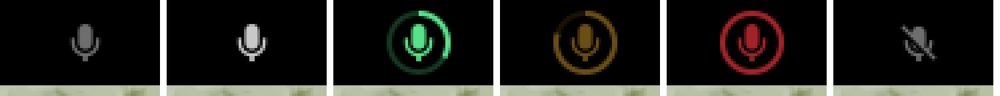
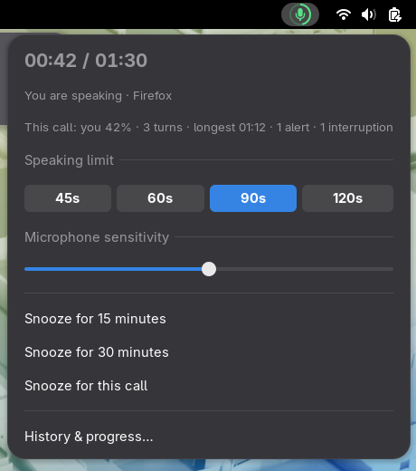
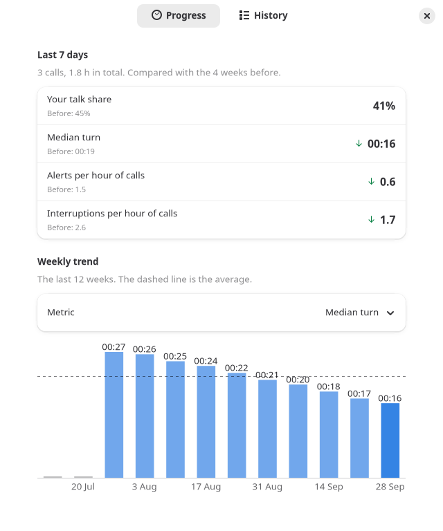

# Respire

*Tómate un respiro.* A small GNOME tool that shows, in the top bar, how long
you have been talking during a call. It nudges you to pause and let other
people speak.



| State | Meaning |
| --- | --- |
| Standby (dim) | No call detected, so the microphone is not being read |
| Idle | In a call, listening, and you are not talking |
| Speaking (green ring) | The ring fills as your current turn gets longer |
| Warning (amber, breathing) | 75% of your limit: look for a place to pause |
| Alert (red, flashing) | Limit reached. You also get a notification |
| Snoozed (crossed mic) | Paused for 15 or 30 minutes, or until the call ends |



## How it works

```text
GNOME Shell top bar ── extension (GJS) ── reads properties, draws the ring
                              │
                     D-Bus session bus  io.github.mmontiel0904.Respire
                              │
respired (Rust) ── meeting detection: polls pw-dump for other apps capturing the mic
                ── capture: pw-record, 16 kHz mono, 100 ms frames (only during calls)
                   · the microphone (you)
                   · the speaker output (the other people in the call)
                ── energy VAD with adaptive noise floor, one per capture
                ── turn tracker: your turn ends after 3 s of silence
```

- **Listens only during calls.** Respire opens the microphone only while
  another application (browser, Zoom, Slack, …) is capturing it. So the GNOME
  microphone privacy indicator is only on when it would be on anyway.
- **Measures turns, not syllables.** A turn starts when you speak and ends
  after 3 seconds of silence. Short pauses between sentences stay inside the
  turn.
- **Knows your talk share.** Respire also listens to your speaker output
  during calls, so it knows when the other people talk. It shows your share
  of the talk time ("you 42%") and counts interruptions: a turn of 1.5 s or
  more that you start while someone else is still talking.
- **Keeps a private log.** At the end of each call, you get a summary
  notification, and one summary line goes to
  `~/.local/state/respire/sessions.jsonl`: turns, talk time, longest and
  median turn, talk share, interruptions, warnings, alerts. Nothing else is
  recorded.

### History and progress

Open **History & progress…** from the popover.



- **Progress** compares your last 7 days with the 4 weeks before them: talk
  share, median turn, alerts per hour, and interruptions per hour. A weekly
  chart shows the last 12 weeks.
- **History** lists your calls from the last 60 days. You can clear the
  history from this page.

The window reads the log file directly. It does not need the daemon.

### Privacy

Audio is processed in memory, 100 ms at a time, and then discarded. It is never
written to disk. This applies to both captures, the microphone and the speaker
output. To turn off the speaker capture, set `track_others = false`. Then
talk share and interruptions are not measured. The systemd unit sets `RestrictAddressFamilies=AF_UNIX`, so the
daemon cannot open network sockets at all.

## Install (Fedora 44, GNOME 50)

```sh
sudo dnf install rust cargo pipewire-utils   # pipewire-utils provides pw-record and pw-dump
git clone https://github.com/mmontiel0904/respire.git
cd respire
make install
```

`make install` puts files under `~/.local`, in your user systemd directory and
in your GNOME extensions directory. It then enables `respired.service`. On
Wayland, log out and back in so GNOME Shell sees the new extension. Then run:

```sh
gnome-extensions enable respire@mmontiel0904.github.io
```

To remove everything: `make uninstall`.

## Configuration

`~/.config/respire/config.toml`. Every key is optional. Changes made in the
popover (limit, sensitivity) are written back to this file.

```toml
time_limit_sec = 90       # alert after this much continuous talking
warning_ratio = 0.75      # warning starts at this fraction of the limit
silence_reset_sec = 3.0   # this much silence ends your turn
sensitivity = 0.5         # 0 = only loud speech counts, 1 = quiet speech counts
mode = "meeting"          # "meeting" (only during calls) or "always"
source = ""               # PipeWire source node name; empty = default mic
ignore_apps = ["pavucontrol", "gnome-control-center", "easyeffects"]
track_others = true       # also listen to the speaker output, for talk share and interruptions
log_sessions = true
```

Restart the daemon after you edit the file: `systemctl --user restart respired`.

### Reviewing your calls

Use the **History & progress** window, or read the log with `jq`:

```sh
jq -r '[(.start|todate), .apps[0], "\(.turns) turns", "longest \(.longest_turn_sec)s", "share \(.talk_share)", "\(.alerts) alerts"] | @tsv' \
  ~/.local/state/respire/sessions.jsonl
```

Each line is one call. Lines with `"v": 2` also have `median_turn_sec`,
`others_talk_sec`, `talk_share` (0.0 to 1.0) and `interruptions`. These are
`null` when `track_others` is off. Older lines have no `v` and no such fields.

## Known limitations

- **Speakers leak.** If you use speakers instead of headphones, other people's
  voices reach your microphone and count as your speech. This also makes your
  talk share too high and adds false interruptions. Use headphones, or create
  a PipeWire echo-cancel source and set `source` to it.
- **All speaker output counts as "others".** A video that you play during a
  call, or notification sounds, count as other people talking.
- **Muting in the call app is not detected.** Meet and Zoom mute inside the
  app, and the microphone stream stays open. Respire still hears you, so use
  *Snooze for this call* if needed.
- **The VAD is energy-based.** Loud typing, coughs, or people talking near you
  can count as speech. Use the sensitivity slider to adjust it. A model-based
  VAD is on the roadmap.
- **Any microphone capture counts as a call**, including dictation apps and
  voice recorders. Add these apps to `ignore_apps`.

## D-Bus API

Bus name `io.github.mmontiel0904.Respire`, object `/io/github/mmontiel0904/Respire`,
interface `io.github.mmontiel0904.Respire1`. Every property emits
`PropertiesChanged`.

| Property | Type | |
| --- | --- | --- |
| `State` | `s` | `standby`, `snoozed`, `idle`, `speaking`, `warning`, `alert` |
| `TalkingTime` | `u` | seconds in the current turn (updates at 1 Hz) |
| `TimeLimit` | `u` | seconds |
| `Progress` | `d` | `TalkingTime / TimeLimit`, 0.0 to 1.0 |
| `Sensitivity` | `d` | 0.0 to 1.0 |
| `MeetingApps` | `as` | applications capturing the microphone |
| `SnoozeRemaining` | `u` | seconds; 0 when not snoozed or snoozed until the call ends |
| `TurnCount`, `LongestTurn`, `AlertCount`, `InterruptionCount` | `u` | statistics for the current call |
| `TalkShare` | `d` | your share of the talk time in the current call, 0.0 to 1.0; -1 when not known |

Signal: `SessionFinished(s summary)` when a call ends. `summary` is the same
JSON as the log line. The signal is sent even when `log_sessions = false`.

Methods: `SetLimit(u seconds)` (10 to 3600), `SetSensitivity(d)`,
`Snooze(u minutes)` (0 = until the call ends), `Resume()`.

```sh
busctl --user introspect io.github.mmontiel0904.Respire /io/github/mmontiel0904/Respire
```

## Development

```sh
make lint         # rustfmt + clippy
make test         # daemon unit tests and history tests (gjs)
make shell-test   # load the extension in a headless GNOME Shell with a mock daemon; screenshots go to build/shots/
make prefs-shot   # render the History & progress window offscreen with made-up calls; screenshots go to build/shots/
make run          # run the daemon in the foreground with debug logs (stop the service first)
journalctl --user -u respired -f
```

See [docs/design.md](docs/design.md) for design decisions and the roadmap.

## License

GPL-2.0-or-later, the same license as GNOME Shell.
